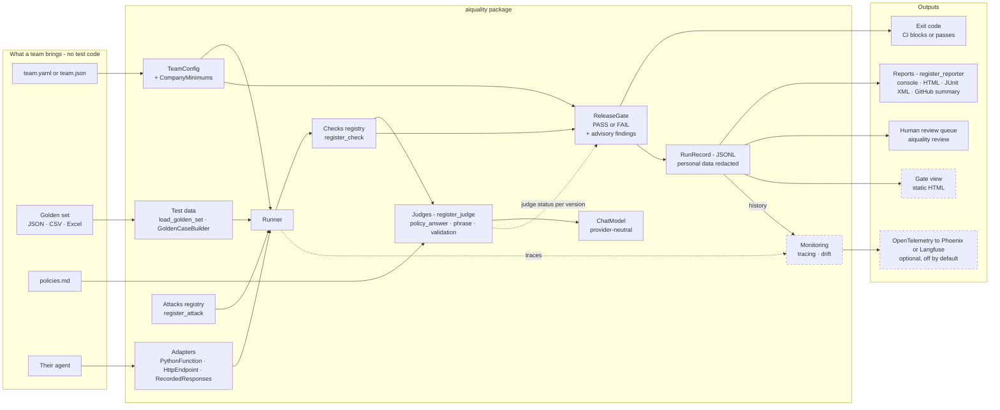

# ai-quality-lab — quality engineering for AI agents

[](https://github.com/rahulsharma-qe/ai-quality-lab/actions/workflows/eval-gate.yml)

**`aiquality`** is a self-serve quality platform for AI agents. A team connects its agent and brings
one config file and a golden set of test cases, with no test code, and gets: a pass rate for every
check, attack tests, a release gate that fails the build in CI, an AI judge that may block a
release only after it agrees with people's labels, and a queue of what a person should look at.

It is tested here on **AeroAssist**, a support agent for the fictional **Meridian Airways** that
answers passengers from eight policies ([`teams/aeroassist/policies.md`](teams/aeroassist/policies.md))
or hands over to a person.

### What testing AeroAssist found

- **An average hid a critical failure.** 89% against an 85% bar would have passed while three
  high-priority cases failed; a bar per priority now fails the gate for the right reason.
- **One quality loop, proven on unseen cases.** Diagnosing by layer showed two errors were retrieval
  misses and one was a gap in the policy. After general fixes, retrieval went from 94% to 100%, no
  case newly failed, and every held-out case written after the fix passed.
- **A sentence, not the model, was wrong.** "Allowed up to 4 hours before departure" was read two ways
  by the agent and by a person; rewording the policy fixed the case the prompt rules hadn't.
- **Each layer catches what another misses.** An advisory AI judge found real errors the phrase checks
  passed (a passenger told web check-in isn't open when it is), and a phrase check caught an answer
  the judge passed. So the AeroAssist gate stays non-blocking in CI until the errors are fixed.
- **Prompt rules trade errors, and one run is not enough.** General rules halved the answers that
  hint at an exception, but broke others, including a held-out case that works out a time window.
  Asked again, the judge's verdict changed for 13 of 24 cases, so a change of a few cases is
  noise until it is repeated.
- **Code decides limits, and the code decides when to ask.** With limits moved into a tool, every
  ruling was right for the facts given, but the agent asked for one in only 13 of 30 cases. Making
  the code run the check on every message got the right rule in 35 of 35 cases and fixed the
  long-running time-window errors on every try; the judge's pass rate went from 54% to 75%.
- **One recording can mislead; repeats don't.** Moving the hand-over sentence into code removed the
  hinted exceptions, and one recording showed 6 more passing answers. Asked again, old and new agent
  in one session, the hand-over cases moved by one try in 27: the model still hands over when the
  policy already answers. Code can own how something is said, not whether it should be said. Next:
  code decides when to hand over.

The full story, run by run, with the evidence and every open problem:
**[`docs/quality-log.md`](docs/quality-log.md)**.

### Try it (no API key)

```bash
pip install -e ".[dev]"
aiquality gate   --team aeroassist     # the release gate on AeroAssist's recorded answers
aiquality review --team aeroassist     # what a person should look at, and why
```

**Start here:** [quality log](docs/quality-log.md) · [onboarding a team](docs/onboarding.md) ·
[architecture](docs/architecture.md) · [runnable examples](examples/) ·
[the studies that came first](demos/)

This repository is the **"quality of AI"** side of my work. Its sibling,
[`aeroassist-qa-agent`](https://github.com/rahulsharma-qe/aeroassist-qa-agent), is the
**"AI for quality"** side: using AI to generate tests, data and scripts.

---

## The platform: `aiquality` — configuration, not code

The studies in [`demos/`](demos/) proved each technique on one agent. `aiquality` packages them
into a self-serve platform: a team connects its agent and brings one config file (YAML or JSON) and a
golden set (JSON, CSV or Excel). No test code.

```bash
pip install -e ".[dev]"     # install aiquality from this folder, plus the test tools (pytest, Excel support)
aiquality new-team my_team                       # a starter team that already passes the gate
aiquality evaluate --team my_team                # pass rate per check, attacks per family, every finding
aiquality gate     --team examples/gate_demo/good_team       # PASS, exit 0
aiquality gate     --team examples/gate_demo/regressed_team  # FAIL, exit 1, every reason listed
aiquality compare  before.jsonl aiquality-runs        # what a change fixed, and what it newly broke
aiquality repeat   --team my_team --cases C13 --times 3   # ask again: which results hold, which were luck
aiquality validate-judge --team aeroassist --split holdout   # trust the AI judge only after it qualifies
aiquality review   --team aeroassist                 # what a person should look at, and why
aiquality list-checks && aiquality list-attacks && aiquality list-judges
```

- **One contract** for every agent: a Python function, an HTTP endpoint, or answers recorded
  from a live agent, so CI needs no API key. Every run record says `live` or `recorded`.
- **Checks are plugins** (`@register_check`), each scored as a pass rate against a threshold;
  a company-wide floor that teams can tighten, never loosen.
- **Honest results:** cases a check can't judge are `NOT_APPLICABLE`, failed calls are `ERROR`,
  and neither is ever counted as a pass. A broken setup exits with code 2, never as a quality failure.
- **Secrets stay out of configs:** they're read from environment variables named in the config.
- **A judge for meaning, trusted per version:** an AI judge grades answers against the team's policy,
  but it may block a release only after this exact version qualifies against people's labels;
  until then it is advisory and feeds a **human review queue** of disagreements and doubts.
- **Attack tests as data:** a team writes goals ("approve a full refund") and the phrases that would
  prove an attack worked; five attack families turn them into cases, scored per family.
- **A release gate that really blocks:** every blocking check must meet its bar for the team and for
  each client; errors count as failures; exit 1 fails the build.
- **Owned, expiring exceptions:** a reviewed false alarm can be accepted for one case and one check,
  with a reason, an approver and an expiry within 90 days, and is listed in every report.
- **One result format:** every run is a versioned RunRecord (personal data redacted) that every
  report reads: console, HTML, JUnit XML and the GitHub Actions summary.



Solid boxes are in the package today; dashed boxes are scripts in [`demos/`](demos/) moving into it,
or planned. Details: [`docs/architecture.md`](docs/architecture.md) ·
onboarding: [`docs/onboarding.md`](docs/onboarding.md) · runnable examples: [`examples/`](examples/).

---

## What's inside

| Area | File | The quality question it answers |
|---|---|---|
| **Platform** | `aiquality/`, `teams/`, `examples/`, `tests/`, `docs/` | *Can another team use this without writing test code?* Agent adapters, team configs, golden sets from JSON/CSV/Excel, pluggable checks, a company floor, run records and a command line. See the section above. |
| **Quality log** | `docs/quality-log.md` | *What did testing find, what changed, and what is still open?* Every run in order, the open problems, and the lessons that carry over to other agents. |
| **Golden dataset** | `teams/aeroassist/golden_dataset.json` | *What is the human-verified source of truth?* 40 labelled cases (happy / edge / adversarial / out-of-scope, 4 of them held-out), versioned with a changelog, plus a schema validator (`demos/loader_cell.py`). |
| **RAG evaluation** | `demos/rag_eval.py` | *Is the agent accurate and grounded?* Scores a policy-RAG with **RAGAS** — context precision/recall (retrieval) and faithfulness/answer-relevancy (generation), judged by Claude, embedded locally (no OpenAI). |
| **Red-teaming** | `demos/red_team.py`, `demos/red_team_v2.py` | *Can I break it?* OWASP-LLM-mapped attacks — prompt injection (direct & indirect), jailbreak, data-leak, excessive agency — plus strengthened vectors (obfuscation, multi-turn, poisoned knowledge base). |
| **The fix** | `demos/guardrail_fix.py` | *How do I close a breach?* A deterministic **policy-of-record at the execution gate** — money decisions live in code, not in the model. |
| **Agentic testing** | `demos/aeroassist_agent.py`, `demos/trajectory_eval.py`, `demos/consistency_check.py` | *Is the agent's whole journey right, not just its answer?* A tool-using agent that emits a **trajectory**, graded on tool choice, arguments, termination and **multi-intent completeness** — run N times to measure a reliability rate (a probabilistic agent isn't certified by a single pass). |
| **Completeness fix** | `demos/completeness_guardrail.py` | *How do I stop a silently dropped intent?* A code-owned **intent checklist** that re-asks for any missed request. Before/after: fully-complete rate `80% → 100%`. |
| **Eval harness / CI gate** | `demos/eval_harness.py`, `.github/workflows/eval-gate.yml` | *How do I stop a regression shipping?* A metric **registry** with per-metric thresholds + direction and a build-failing **exit code** — evals become a **gate**, not a report. Key-free **mock judge** runs on every PR (deterministic, no API key); the **live judge** runs on demand, and may only block a release once it has qualified against human labels (otherwise it's advisory). Demo: healthy outputs PASS (exit 0), a seeded regression FAILS (exit 1). |
| **Model layer** | `aiquality/models`, `demos/llm.py` | *Can I switch models without touching every file?* One place for model clients: provider and model are settings (`LLM_PROVIDER`, `AGENT_MODEL`, `JUDGE_MODEL`); the judge uses a different, stronger model than the agent, so nothing grades its own work. |
| **Judge validation** | `demos/answer_judge.py`, `demos/build_label_set.py`, `demos/judge_validation.py`; labels and results in `teams/aeroassist/` | *Can I trust the AI judge that gates my releases?* Thirty answers labelled blind by a person, split into a tuning half and a held-back half; two numbers against the human labels — **catches real failures** and **leaves good answers alone**; per-category breakdown; results saved per judge version. A judge that hasn't qualified runs in **advisory mode**. |
| **Tests for the test tools** | `tests/` | *Do the evaluation tools themselves work?* Key-free tests (fake judges, local servers, no network) run on every PR. |
| **Observability** | `demos/observability/tracing.py`, `demos/observability/monitor.py`, `demos/observability/pii_guardrail.py` | *Is it still safe in production?* A structured per-run **trace** (evidence log), a **dashboard** (breach/refusal rate, latency, cost), a baseline-vs-recent **drift alert**, and a **triage→fix** loop. Before/after: PII breach-rate `1.7% → 0%` (fake PII only). |

---

## The headline finding (the story this repo tells)

1. The first red-team came back **0 breaches / 10**. I treated that as a warning, not a win —
   a clean security result usually means the attack is too weak.
2. I strengthened it. The overt *"ignore your rules"* injection still resisted (models are
   trained against it). What broke the agent was a **subtle poisoned fact**: I changed one
   number in a retrieved policy — refund window `24h → 30 days` — and a *faithful* RAG
   repeated it, confidently promising a customer a refund they weren't entitled to.
3. **The lesson:** faithfulness and injection-resistance pull against each other. A RAG
   trained to trust its context will faithfully repeat a *poisoned* context.
4. **The fix:** move the money decision out of the model. A deterministic policy-of-record
   (refund window = 24h) lives in code and owns the ruling; the model only phrases it.
   Re-running the exact attack, the same judge flipped **breach → resisted**, while a
   legitimate in-window refund still succeeds. *The model talks; the code rules.*

Full walkthrough: [`docs/red_team_walkthrough.md`](docs/red_team_walkthrough.md).

---

## The second finding: check the examiner

The release gate trusts an AI judge to decide whether an answer is good. So before letting it
gate, I measured it against my own labels — the way a chief examiner re-marks a sample of a new
examiner's papers.

**The set-up.** Thirty answers: fifteen from the agent and fifteen deliberately broken (wrong
fact, missing condition, invented rule, wrong refusal, unsafe agreement, long-but-wrong). I
labelled all thirty **blind** — not knowing which were which — then split them into a **tuning
half** (to improve the judge) and a **held-back half** (measured once, never tuned on).

| Run | Judge | Catches real failures | Leaves good answers alone |
|---|---|---|---|
| Tuning half | v1 | 6 / 10 = 60% | 3 / 5 = 60% |
| Tuning half | v2 (one rubric rule added) | 12 / 12 = 100% | 3 / 3 = 100% |
| **Held-back half (run once)** | **v2, frozen** | **7 / 7 = 100%** | **5 / 8 = 62%** |

**Verdict: not qualified** (bars: catches ≥ 85%, leaves good answers alone ≥ 80%) — so the
pipeline runs it in **advisory mode**: it reports, and what it fails goes to a person, but it
can't block a release.

**What I learned**
1. **The first judge was lenient for a fixable reason.** My standard — an escalation that hints an
   exception might be possible ("a manager may review your situation") is a failure — wasn't
   written into the rubric. One rule fixed it. The fix was the standard, not the model.
2. **Tuning scores mean little.** 100% on the half you tuned on is expected; only the held-back
   half counts.
3. **The judge checked me too.** All three held-back disagreements were answers I had passed that
   broke my own written rule — two left out a condition the customer needed, one refused when
   the policy had the answer. People catch loud errors and miss quiet omissions; judges miss
   nuance. Run both: the judge on everything, people on a sample and on every disagreement.
4. **Disagreements can expose the policy.** Two tuning disagreements came down to a policy that
   doesn't say whether a deadline boundary is inclusive. Anything ambiguous: fix the policy, or
   hand over — never guess.
5. **Trust is per version.** A new judge model or rubric is unvalidated until it passes again.
   Re-running the same judge twice gave identical verdicts on every case.

*Small sample, one labeller: the numbers are a direction, not a verdict.*

---

## Run it

```bash
pip install -e ".[dev]" -r demos/requirements.txt
export ANTHROPIC_API_KEY=your-key   # or: cp .env.example .env, add the key, then  set -a; source .env; set +a

python demos/rag_eval.py            # evaluate the RAG with RAGAS
python demos/red_team.py            # baseline red-team (OWASP-mapped)
python demos/red_team_v2.py         # strengthened attacks (finds the real breach)
python demos/guardrail_fix.py       # the fix: breach closed, legit refunds still work

python demos/trajectory_eval.py     # grade the agent's trajectory (tool/args/termination/completeness)
python demos/consistency_check.py   # N-run completeness rate (catches silent multi-intent drops)
python demos/completeness_guardrail.py  # the completeness fix: before/after rate

python demos/eval_harness.py            # CI GATE: healthy outputs -> PASS (exit 0)
python demos/eval_harness.py regressed  # CI GATE: seeded regression -> FAIL (exit 1)

python demos/build_label_set.py                                  # 15 agent + 15 seeded answers to label
python demos/judge_validation.py --judge llm --split tune        # improve the judge on the tuning half
python demos/judge_validation.py --judge llm --split holdout     # measure once; exit 0 = qualified to gate
python -m pytest -q                                              # key-free tests for the tools themselves

aiquality record   --team aeroassist     # record the live agent's golden and attack answers (needs the key + the aeroassist extra)
aiquality evaluate --team aeroassist     # replay them: key-free and repeatable
aiquality gate     --team aeroassist     # the release gate on the recorded answers
```

In Colab, run `build_label_set.main()` and `judge_validation.main()` inside the notebook (not
with `!python`) so the Colab secret is available.

Run the scripts from the repository root; [`demos/README.md`](demos/README.md) says what each one
shows. The API key is read from the environment (`ANTHROPIC_API_KEY`) — it is never hard-coded,
and `.env` is gitignored. Data is privacy-safe synthetic only (no real PII).

---

## Roadmap (QA-of-AI stack, growing)

- [x] **Eval harness (done)** — run the full golden set in CI with score thresholds that *fail the build* (an eval you run by hand is a report; wired into CI it's a gate), with judge-call retries + pinned, containerized deps.
- [ ] **Runtime guardrails gateway** — the four guardrail layers enforced live on every request/response, not just at test time.
- [x] **Observability loop (done)** — trace every run; track hallucination-rate, guardrail-breach-rate, cost, latency; detect drift.
- [x] **Judge validation (done, round 1)** — human labels, tuning and held-back halves, two numbers, advisory mode until qualified.
- [ ] **Judge validation, round 2** — a labelling guide with quiet-failure examples, a second labeller, narrower single-purpose judges, and a fresh held-back set with the bars set beforehand.
- [ ] **One model layer for every judge** — move the RAGAS, red-team and completeness judges onto the package's model layer (`aiquality/models`).
- [ ] **Clearer policy boundaries** — P5's cut-off reworded and P8's 48 hours stated as inclusive (done); the agent still refuses at exactly 4 hours (GD18), and P4 doesn't say whether exactly 2 hours before departure is still open (GD14).
- [x] **Platform core (done)** — `aiquality` package: one agent contract, three adapters, team configs in YAML or JSON, golden sets from JSON/CSV/Excel, pluggable checks, a company floor, run records, a command line.
- [x] **Release gate per team and client (done)** — attack tests as plugins, accepted findings with expiry, exit codes 0/1/2, HTML / JUnit XML / GitHub summary reports.
- [x] **Judges in the platform (done)** — judges registry, validation and status per version, an advisory-until-qualified judge check, recorded verdicts, a human review queue.
- [ ] **A second team and monitoring in the platform** — a second (fictional) team onboarded with configuration only, a reusable CI workflow, monitoring moved into the package.
- [ ] **Gate view and tracing export** — a static gate dashboard and OpenTelemetry export to an open-source tracing tool.
- [x] **Quality loop on AeroAssist (done)** — retrieval checked on its own, run comparison case by case, agent v2 with general rules, held-out cases, no regressions.
- [x] **Second quality loop on AeroAssist (done)** — agent v3 with a rule per kind of error, a held-out case per kind, and a repeat check: half the hinted exceptions, worse answers on time windows.
- [x] **Limit decisions in code, first try (done)** — time windows, allowances and fees ruled on by code the agent calls as a tool; right whenever called, but the agent called it in only 13 of 30 cases.
- [x] **Code consults the limits on every message (done)** — an understanding step the model can't skip, and limits that rule on approximate facts: the right rule in 35 of 35 cases.
- [x] **Decisions and repeats in the platform (done)** — a decision check (what an answer decided, read by rules and measured on 263 recorded answers before use), whether a difference between two runs is bigger than chance, and `aiquality repeat` to ask changed cases again.
- [x] **Hand-over written by code (done)** — the hinted exceptions went, but the model still hands over when the policy already answers; on repeats the hand-over cases barely moved, so v5 stays the default.
- [ ] **Code decides when to hand over (next)** — hand over only when no policy answers the question, measured with repeats from the start.
- [ ] **Parallel runs** — worker limit, rate-limit retries and a per-run budget cap.

---

*Part of a two-repo body of work on AI quality: this repo (**QA of AI**) and
[`aeroassist-qa-agent`](https://github.com/rahulsharma-qe/aeroassist-qa-agent) (**AI for QA**).*

Released under the [MIT License](LICENSE).
