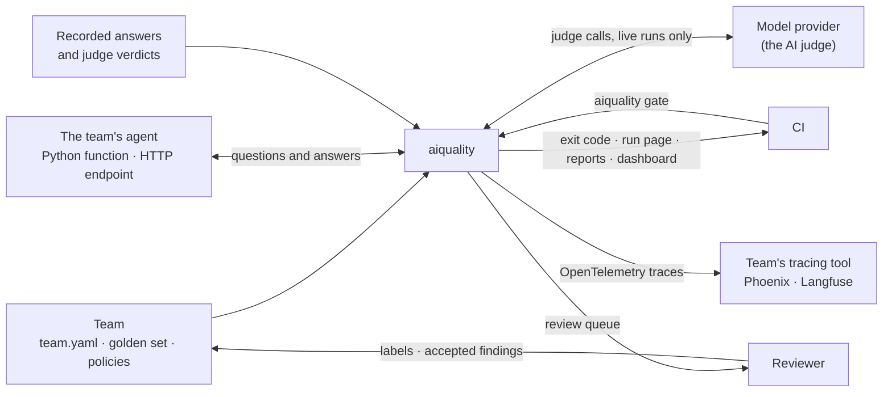
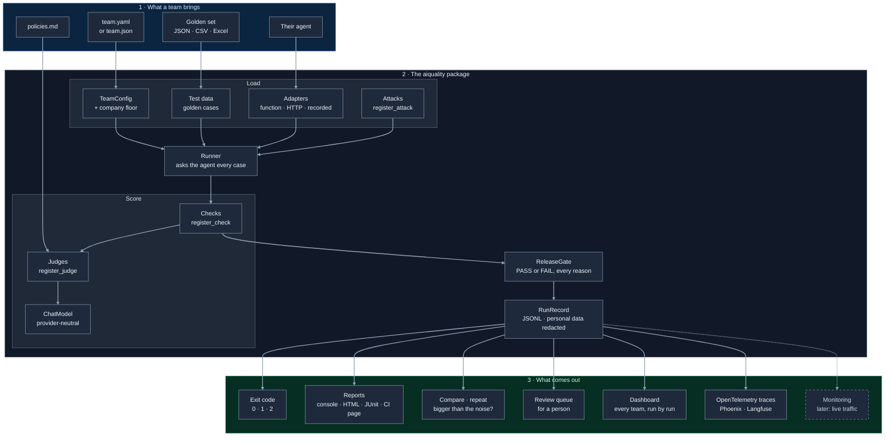
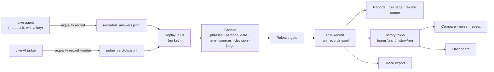
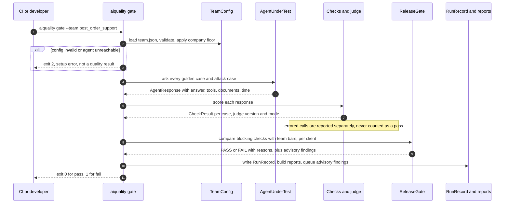
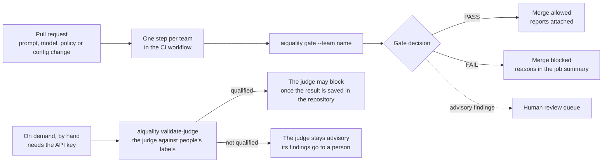

# aiquality: high-level design

`aiquality` turns this repository's evaluation work into a self-serve platform. A team
connects its agent and brings one config file and a golden set, with no test code. It gets
evaluation, attack tests, a release gate, a human review queue, reports, a dashboard and trace export.

This is the high-level design: what the platform is for, who uses it, its parts and how data moves
through them, where it runs, and the decisions behind it. The low-level design, with the modules,
classes, data formats and algorithms, is in [`lld.md`](lld.md).

**Status key:** solid boxes are in the `aiquality` package today. The dashed box, monitoring, is
studied in `demos/observability/` and waits for live traffic to watch.

## 1. Goals and non-goals

**Goals**

- Any team tests its AI agent by **configuration, not code**: an agent adapter, a config file and a
  golden set.
- One **release gate** that a CI job can trust: PASS, FAIL with every reason, or a setup error that
  is never mistaken for a quality result.
- **Honest results**: a case a check can't judge, or a call that failed, is never counted as a pass;
  an AI judge may block only after it has been measured against a person's labels.
- **Key-free and repeatable in CI**: a live agent is recorded once and replayed, so every change is
  checked without an API key and gives the same result every time.
- **Evidence over averages**: case-by-case comparison, whether a difference is bigger than chance,
  and repeat checks, so a lucky run isn't read as a fix.
- **Extensible without forking**: checks, attacks, judges and reports are plugins.

**Non-goals (today)**

- Watching live production traffic (monitoring is studied in `demos/observability/` and waits for
  live traffic).
- Hosting or serving agents or models; the platform calls an agent, it doesn't run one.
- Tracing the agent's own internal steps; the platform sees the agent from the outside.
- A web service or database; everything is files (JSONL, HTML, JSON) that live in the repository or
  in CI artifacts.

## 2. Who uses it, and what it talks to

| Actor | What they do with the platform |
|---|---|
| A team that owns an agent | Writes `team.yaml`, the golden set and its policies; connects its agent; reads the gate and the reports |
| A reviewer (a person) | Labels answers for judge validation; reads the review queue; approves accepted findings, each with an expiry |
| CI (GitHub Actions) | Runs every team's gate on each change, key-free; publishes the run page, the reports and the dashboard |
| The platform owner | Sets the company floor (mandatory checks, minimum bars) that every team must meet |

## 3. Components

| Part | Status |
|---|---|
| Contracts, adapters, team config, company minimums, test data, runner, checks registry, attacks registry, release gate (per team and client, accepted findings), RunRecord, console / HTML / JUnit XML / GitHub summary reports, command line | In the package |
| Model layer, judges registry, judge validation and status per version, answer_judge check (advisory until qualified), recorded verdicts, human review queue | In the package (the study scripts `demos/llm.py`, `demos/answer_judge.py` and `demos/judge_validation.py` now wrap it) |
| Decision check (`expected_decision`), run comparison with noise statistics, `aiquality repeat` | In the package |
| Dashboard (`aiquality dashboard`), OpenTelemetry trace export (`aiquality export-traces`) | In the package |
| A second team onboarded with configuration only (`teams/post_order_support/`) | In the repository |
| Monitoring | Studied in `demos/observability/`; moves into the package when there is live traffic |
| Reusable CI workflow, agent tracing (the agent tracing its own steps) | Later: when another repository runs the gate; when there are live runs |

## 4. How data moves: from a live answer to a release decision

A live run happens rarely, in a notebook where its cost is watched: the agent's answers and the
judge's verdicts are recorded once and committed. Every change after that replays them in CI. A run
worth keeping is saved as a history folder, which the comparison, the repeat check and the dashboard
read. A recording is replaced only by recording again, so a code change alone doesn't change what
CI replays.

## 5. One gate run, step by step

`aiquality gate` runs all of these steps, and `aiquality review` lists the advisory (judge) findings
a person should look at. `aiquality evaluate` runs the same steps without the decision and never blocks.
Exit codes: 0 done or pass · 1 quality below the bar (release gate) · 2 setup error.

## 6. Where it runs

| Place | What runs there | Key needed |
|---|---|---|
| A developer's machine | Every command; tests; examples; gates on recorded answers | No (only for live runs) |
| A notebook (Colab) | Live recordings, live judge verdicts, repeat checks; the person watches the cost | Yes, as a notebook secret |
| CI, on every change | Tests, examples, every team's gate on recorded answers, the run page, the dashboard | No |
| CI, by hand | Measuring the judge against people's labels | Yes, as a CI secret |

## 7. How a team uses it in CI (today each team adds one step; a reusable workflow comes when another repository runs the gate)

In this repository the per-change checks run without an API key: demo agents, recorded
answers and rule-based checks. A team testing its live agent gives the workflow that agent's
access through CI secrets. Blocking a merge also needs branch protection in that repository.

## 8. Quality attributes, and how the design meets them

| Attribute | How |
|---|---|
| Repeatable | Recorded answers and recorded verdicts; temperature 0 for live runs; every run record says `live` or `recorded` |
| Honest | `NOT_APPLICABLE` and `ERROR` are counted apart from passes; a setup error exits 2, never 1; an unqualified judge is advisory |
| Safe with data | Personal data is redacted in run records (questions, answers, evidence, tool arguments); configs that look like they hold a secret are rejected |
| Extensible | Registries for checks, attacks, judges and reports; adapters for agents; a team's own plugin files |
| Traceable | Versions everywhere: agent, policies, limits code, golden set, judge, run-record schema |
| Cheap to run | Key-free CI; live runs only when an agent changes, with the cost printed before repeats run |

## 9. Key design decisions and their trade-offs

- **One contract.** Every agent is reached through `answer(question, conversation) -> AgentResponse`.
  Evidence the adapter can't see (tool calls, retrieved documents) stays `None`, and checks that
  need it report `NOT_APPLICABLE`, never a pass.
- **Every check is a pass rate.** Each check decides PASS or FAIL per case; the score is
  PASS / (PASS + FAIL), compared with a threshold. Not-applicable cases and errors are counted
  and shown, never folded into the score.
- **Configuration, not code.** Team settings are validated against a schema, every problem is
  listed at once, and the company floor applies: a team can be stricter, never looser.
- **Secrets stay out of files.** Configs name environment variables; anything that looks like a
  secret in a config is rejected.
- **Recorded answers keep CI key-free.** A live agent's answers are recorded once and replayed;
  every run record says whether it was `live` or `recorded`.
- **Phrase checks are cheap signals.** Whole-word matching avoids substring mistakes, but meaning
  (for example "not approved") needs a judge; a match right after a negation word is flagged.
- **One result format.** Every command writes a RunRecord with a `schema_version`; every report
  reads it.
- **The gate reads strictly.** Errors count as failures, a mandatory check with no applicable case
  fails for lack of evidence, and each client tag must meet the bar on its own.
- **Exceptions are owned and expire.** An accepted finding names one case and one check, a reason,
  an approver and an expiry within 90 days, and is listed in every report.
- **Attacks are data plus plugins.** Teams write goals; families turn them into cases built the same
  way every run, so recorded answers can be replayed.

**What these choices cost**

- **Recordings can go stale.** A code change doesn't change what CI replays until the agent is
  recorded again; every run record names the recorded agent's version, so a stale recording shows.
- **Rule-based checks read words, not meaning.** Phrase checks and the decision reader are cheap and
  repeatable, but a correct answer in other words can fail them; the judge and expiring accepted
  findings cover that gap.
- **A strict gate blocks more often.** Counting errors as failures, and failing a mandatory check
  with no evidence, is the price of never passing on missing evidence.
- **Files, not a service.** Nothing to host or keep running, but no live view: the dashboard is a
  static page built after runs.
- **An advisory judge can't block, even when it is right.** It blocks only after a version qualifies
  against people's labels.

## 10. Limits, and what comes later

- **Monitoring** of live traffic waits for live traffic; it will reuse the checks that need no
  expected answer and the same noise statistics.
- **Agent tracing**: the agent tracing its own steps (retrieval, model calls, tools), linked to the
  test case, needs live runs.
- **A reusable CI workflow** comes when another repository runs the gate.
- **Parallel runs** (worker limit, retries, a budget cap) come when live runs grow.
- The AI judge is **advisory** until a version qualifies against people's labels.
