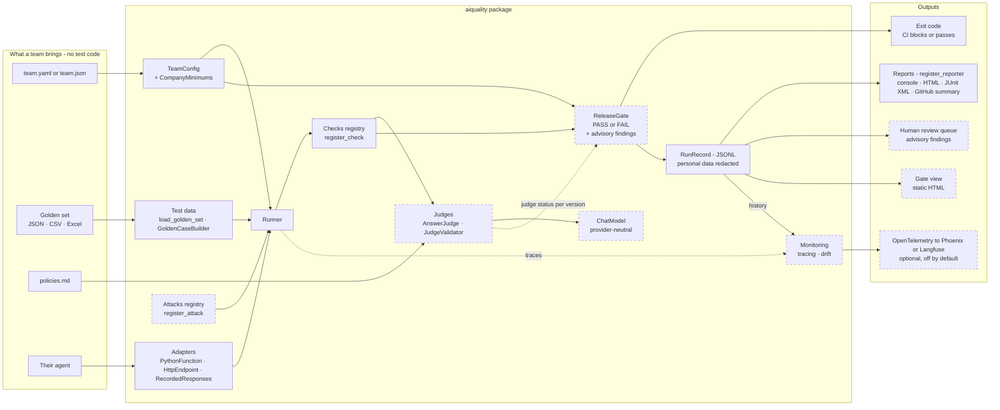
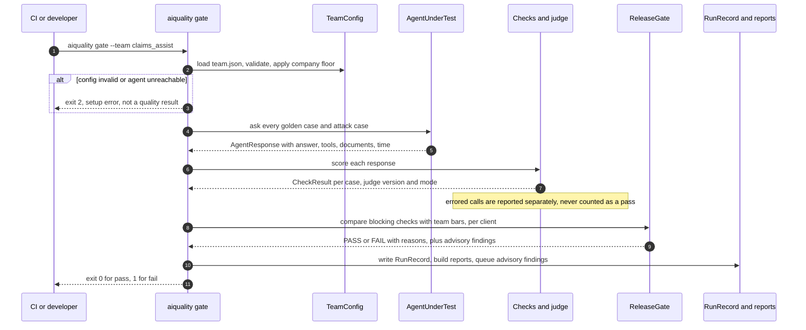
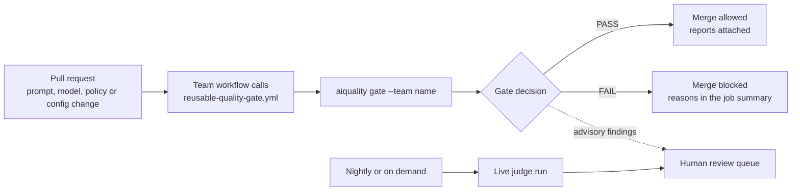

# aiquality architecture

`aiquality` turns this repository's evaluation work into a self-serve platform. A team
connects its agent and brings one config file and a golden set, with no test code. It gets
evaluation, attack tests, a release gate, a human review queue, monitoring and reports.

**Status key:** solid boxes are in the `aiquality` package today. Dashed boxes are either
standalone scripts in this repository that are moving into the package, or planned.

## 1. Components

| Part | Status |
|---|---|
| Contracts, adapters, team config, company minimums, test data, runner, checks registry, RunRecord, console report, command line | In the package |
| Judges, judge validation, model layer, monitoring | Standalone scripts in this repo (`answer_judge.py`, `judge_validation.py`, `llm.py`, `observability/`), moving into the package |
| Attacks registry | Attacks exist as scripts (`red_team.py`, `red_team_v2.py`); registry planned |
| Release gate with per-team and per-client bars, more report formats, human review queue, gate view, tracing export | Planned |

## 2. One gate run, step by step (target design)

Today `aiquality evaluate` runs steps 1 to 6 and 10 (scores and records; it never blocks).
Exit codes: 0 done or pass · 1 quality below the bar (release gate) · 2 setup error.

## 3. How a team uses it in CI (target design)

In this repository the per-change checks run without an API key: demo agents, recorded
answers and rule-based checks. A team testing its live agent gives the workflow that agent's
access through CI secrets. Blocking a merge also needs branch protection in that repository.

## 4. Key design decisions

- **One contract.** Every agent is reached through `answer(question, conversation) -> AgentResponse`.
  Evidence the adapter can't see (tool calls, retrieved documents) stays `None`, and checks that
  need it report `NOT_APPLICABLE`, never a pass.
- **Every check is a pass rate.** Each check decides PASS or FAIL per case; the score is
  PASS / (PASS + FAIL), compared with a threshold. Not-applicable cases and errors are counted
  and shown, never folded into the score.
- **Configuration, not code.** Team settings are validated against a schema, every problem is
  listed at once, and the company floor applies: a team can be stricter, never looser.
- **Secrets stay out of files.** Configs name environment variables; anything that looks like a
  secret in a config is rejected.
- **Recorded answers keep CI key-free.** A live agent's answers are recorded once and replayed;
  every run record says whether it was `live` or `recorded`.
- **Phrase checks are cheap signals.** Whole-word matching avoids substring mistakes, but meaning
  (for example "not approved") needs a judge; a match right after a negation word is flagged.
- **One result format.** Every command writes a RunRecord with a `schema_version`; every report
  reads it.
