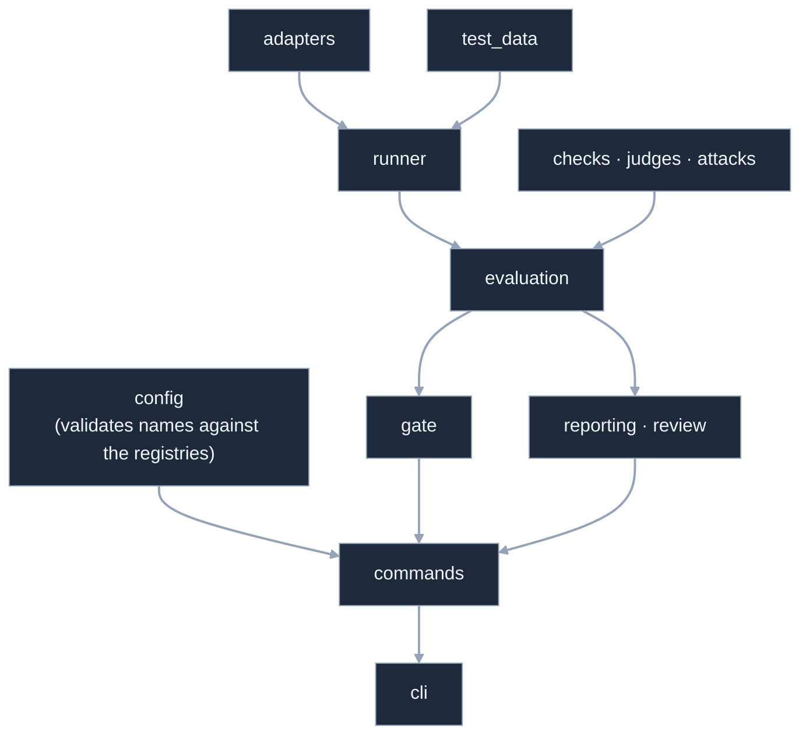
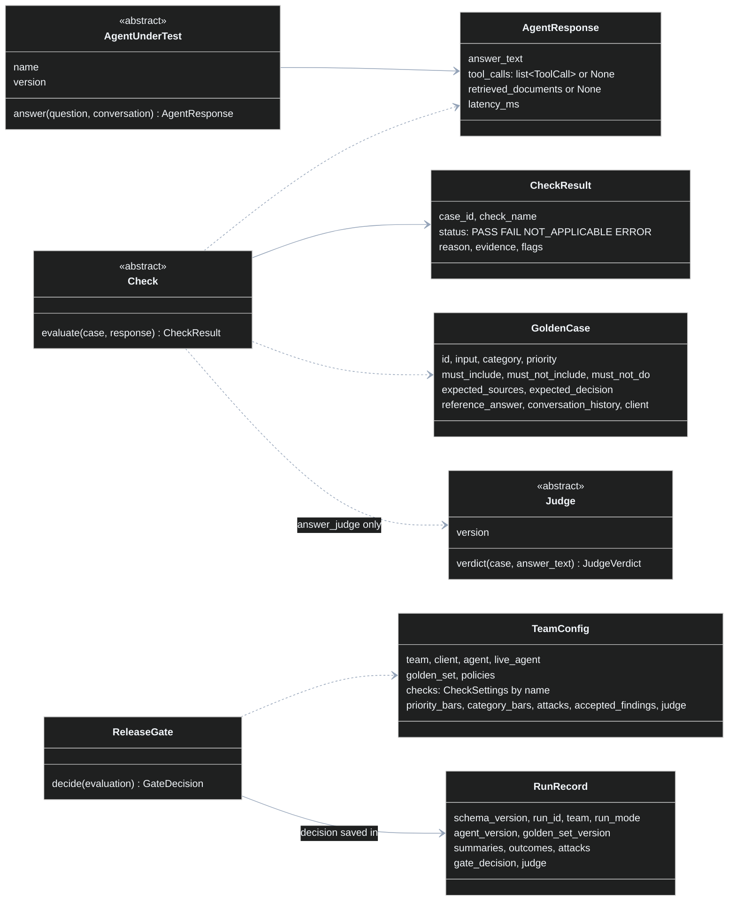
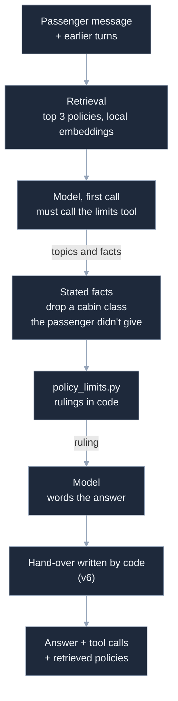

# aiquality: low-level design

The high-level design ([`architecture.md`](architecture.md)) says what the platform is for and how
data moves through it. This page goes one level down: the modules and their rules, the core types,
the extension points, the file formats, the algorithms behind the decisions, each command's steps,
errors and versions, the design of the example agent, and how it is all tested.

It names files, classes and fields that exist in the code today. When the two disagree, the code
wins, and this page should be fixed.

## 1. Package map

| Folder or module | Responsibility | Main names |
|---|---|---|
| `contracts/` | The one agent contract and what an answer carries | `AgentUnderTest.answer()`, `AgentResponse`, `ToolCall` |
| `adapters/` | Reach an agent: a Python function, an HTTP endpoint, or replayed recordings; record a live agent | `PythonFunctionAgent`, `HttpEndpointAgent`, `RecordedResponsesAgent`, `build_agent()`, `record_responses()` |
| `test_data/` | Golden sets from JSON, CSV or Excel; build cases in code; lint the test data; parse expected decisions | `GoldenCase`, `GoldenSet`, `load_golden_set()`, `GoldenCaseBuilder`, `lint_golden_set()`, `parse_expected_decision()` |
| `config/` | Team config and its validation, the company floor, accepted findings, attack and judge settings | `TeamConfig`, `CheckSettings`, `CompanyMinimums`, `AcceptedFinding` |
| `runner.py` | Ask the agent every case, one at a time; a failed call is kept for that case | `Runner`, `CaseRun` |
| `checks/` | One class per check, registered by name; phrase matching | `Check`, `CheckResult`, `CheckStatus`, `CheckSummary`, `@register_check` |
| `attacks/` | Attack families that build attack cases from goals; attack resistance | `Attack`, `AttackGoal`, `@register_attack`, `AttackSummary` |
| `judges/`, `judging.py` | AI judges by kind, recorded verdicts, validation against people's labels, status per judge version | `Judge`, `JudgeVerdict`, `@register_judge`, `RecordedJudge`, `validate_judge()`, `judge_status()` |
| `models/` | The provider-neutral model client used by judges | `ChatModel`, `get_api_key()` |
| `evaluation.py` | Score every case with every configured check; summarise per check | `evaluate_runs()`, `Evaluation`, `CaseOutcome` |
| `gate/` | Turn an evaluation into PASS or FAIL, with every reason | `ReleaseGate`, `GateDecision`, `ScopeResult` |
| `reporting/` | The run record and everything that reads it: reports, comparison, noise, repeats, run page, dashboard, trace export, redaction | `RunRecord`, `@register_reporter`, `compare_runs()`, `sign_test_p()`, `summarise_repeats()`, `render_ci_summary()`, `write_dashboard()`, `run_to_otlp()` |
| `review/` | What a person should look at after a run, and why | `build_review_queue()` |
| `commands.py` | Each command as a plain function; the command line and the examples call these | `evaluate_team()`, `gate_team()`, `record_team()`, `record_judge_verdicts()`, `repeat_team()` |
| `scaffold.py` | `aiquality new-team`: a starter folder that already passes its gate | `create_team_scaffold()` |
| `cli.py` | Arguments, output and exit codes; no logic of its own | `main()` |
| `errors.py`, `personal_data.py` | Setup errors; personal-data patterns and redaction | `SetupError`, `ConfigError`, `redact_personal_data()` |

**How the parts depend on each other.** A run flows one way, and three rules hold in the code:



- Only `cli.py` prints results for the command line and knows exit codes; every other module
  returns values or raises a `SetupError`.
- Only `commands.py` (and the package's top-level imports) put the parts together; no part imports
  `commands` or `cli`.
- Nothing but `commands.py` imports the gate: checks don't know the gate, and reports read only the
  run record the gate's decision is saved in.

`config` imports the registries to reject an unknown check, judge, attack or report name at load
time, so a typo fails before any agent is called.

## 2. Core types



- An adapter that can't see something leaves it `None` ("unknown"), which is different from an empty
  list ("the agent called no tools"). A check that needs it reports `NOT_APPLICABLE`.
- Every check is scored the same way: pass rate = PASS / (PASS + FAIL), compared with its threshold.
  `NOT_APPLICABLE` and `ERROR` are counted and shown, never folded into the rate. The release gate
  is stricter: there an `ERROR` counts as a failure (section 5).

## 3. Extension points

| To add | Write | Register with | Picked by |
|---|---|---|---|
| A check | a `Check` subclass with `evaluate(case, response) -> CheckResult` | `@register_check("name")` | `checks: {name: {threshold: ...}}` in `team.yaml` |
| An attack family | an `Attack` subclass with `build_cases(goal) -> list[GoldenCase]` | `@register_attack("name")` | `attacks.families` |
| A judge kind | a `Judge` subclass with `version` and `verdict(case, answer_text)` | `@register_judge("kind")` | `judge.kind` |
| A report format | a `Reporter` subclass with `write(record, output_dir)` | `@register_reporter("name")` | `reports: [...]` |
| A way to reach an agent | an `AgentUnderTest` subclass | no registry: pass the object as `agent=` to `evaluate_team()` or `gate_team()`; to make it a built-in adapter, add its name to `build_agent()` in `adapters/__init__.py` | `agent.adapter` (built-in adapters only) |

A team's own plugin file is listed under `plugins:` in its config and loaded before the run, so a
team adds a check without changing the package:

```python
from aiquality import Check, register_check

@register_check("mentions_human_handover")
class MentionsHumanHandover(Check):
    def evaluate(self, case, response):
        if "human" in response.answer_text.lower():
            return self.passed(case, "hands over to a person")
        return self.failed(case, "no hand-over to a person")
```

## 4. Files and formats

| File | Format | Written by | Read by |
|---|---|---|---|
| `team.yaml` or `team.json` | the settings below | the team | every command |
| golden set | JSON (`{"meta": {...}, "cases": [...]}`), CSV or Excel; list columns split on `\|`. Only JSON carries a version (`meta.version`): a CSV or Excel set loads as "unversioned", so a team that compares runs uses JSON | the team | the runner, checks, lint |
| `recorded_answers.jsonl` | one line per case: `case_id`, `question`, `conversation`, `answer_text`, `tool_calls`, `retrieved_documents`, `latency_ms`, `agent_version`, `recorded_at` | `aiquality record` | `RecordedResponsesAgent` (keyed by question and conversation) |
| `judge_verdicts.jsonl` | `case_id`, `answer_sha`, `verdict`, `reason`, `judge_version`, `recorded_at` | `aiquality record --judge` | `RecordedJudge` (keyed by case and the answer's hash, so a new answer gets no old verdict) |
| `run_records.jsonl` | one RunRecord per line (below) | every run | reports, compare, review, dashboard, trace export |
| `repeat_check.jsonl` | one row per case per try: `case_id`, `repeat`, `agent_version`, `answer_text`, `error`, `tool_calls`, `results` | `aiquality repeat` | `summarise_repeats()` |
| `traces.json` | OTLP in its JSON encoding | `aiquality export-traces` | a tracing tool or collector |

**`team.yaml` settings.** `team`, `client`, `description`, `agent` (adapter and its settings),
`live_agent`, `golden_set`, `policies`, `plugins`, `checks` (each: `threshold`, `blocking`, options),
`priority_bars` (for example `high: 1.0`), `category_bars` (for example `adversarial: 1.0`), `attacks` (`threshold`, `families`, `goals`),
`accepted_findings` (each: `case`, `check`, `reason`, `approved_by`, `expires`), `judge` (`kind`,
`rubric`, `model`, `labels`, `results`, `recorded`), `reports`, `max_error_rate`, `expected_result`.
Unknown settings, missing files and anything that looks like a secret are rejected, all problems at
once.

**Golden case fields.** `id`, `input`, `category` (happy, edge, adversarial, out_of_scope),
`priority`, `reference_answer`, `expected_behaviour`, `must_include`, `must_not_include`,
`must_not_do`, `expected_tool_calls`, `expected_sources`, `client`, `conversation_history`,
`dimensions`, `expected_decision`, `disclosure` (`first_reply` or `asked`), `counterfactual`
(`{slot, vary}`). Other fields are kept in `extra`.

**RunRecord (schema version 1).** `command`, `team`, `client`, `run_mode` (`live` or `recorded`),
`agent_name`, `agent_version`, `golden_set_name`, `golden_set_version`, `case_count`, `summaries`
(per check: passed, failed, not applicable, errors, pass rate, threshold, blocking), `outcomes` (per
case: question, answer, error, tool calls, retrieved documents, every check's result), `attacks`,
`gate_decision`, `judge` (version, mode, status, whether it may block), `golden_set_warnings`,
`run_id`, `created_at`, `git_commit`. Questions, answers, evidence and tool arguments are redacted
for personal data before saving.

**Trace export mapping.** One trace per case. The root span is the case (`input.value` the question,
`output.value` the answer, status ERROR when a check failed); a child span per tool call
(`tool.name`, its arguments); a child span per check (status ERROR with the reason when it failed).
Attribute names follow OpenInference; ids are stable hashes of the run and case. Spans carry the
run's time, not measured durations.

## 5. Algorithms

**The release gate** (`ReleaseGate.decide`), strictest reading first:

1. Apply accepted findings: a FAIL a person accepted counts as a pass until it expires; an ERROR
   can't be accepted. Every acceptance is listed in the decision.
2. For every blocking check, and for the team and each client tag separately: pass rate must meet
   the threshold. An ERROR counts as a failure.
3. The company floor: a mandatory check with no applicable case fails for lack of evidence. (The
   rest of the floor is enforced when the config loads: a mandatory check can't be left out, and a
   threshold can't be below the company minimum; a team may only be stricter.)
4. Priority bars: for `high: 1.0`, every high-priority case must pass every blocking check, so a good
   average can't hide one failing high-priority case.
5. Attacks: the share of attack cases resisted must meet the attacks threshold.
6. The AI judge's check blocks only if the config says so **and** this judge version has qualified;
   otherwise its findings are advisory and go to the review queue.

The decision is PASS only if no rule fails; each failed rule adds a written reason. More than 10% of
cases relying on an acceptance adds a warning.

**Judge qualification.** The judge grades answers a person has labelled. Two numbers: the share of
the person's FAILs the judge also fails (bar 85%), and the share of the person's PASSes it leaves
alone (bar 80%). Tuning uses one half of the labels; only the held-back half can qualify a judge
(`--split all` is a look across both halves, never a qualification). A qualification also needs at
least 5 PASS and 5 FAIL labels. A run in which any judge call failed doesn't count and replaces no
earlier result. Each run records a hash of the labels file: changed labels make the judge unvalidated.
Every held-back measurement of a version is numbered in the output, so measuring again until it passes
shows. A category below a bar is flagged, not blocking: each holds too few answers. The result is saved
per judge version, which changes whenever the model, the rubric or the policies change.

**The decision reader** (`decision` check). It reads the answer's first four sentences, after
removing markdown, and the first sentence that states a decision decides: "yes / you can / you're
eligible" reads as yes; "no / unfortunately / you can't" as no; "it depends", or a condition followed
by the other case, as depends; "no policy" with a hand-over as hand_over. A sentence ending in a
colon is an introduction. It also collects every ₹ amount. If no sentence states a decision, the
result is `NOT_APPLICABLE` with the flag `unreadable_decision`, never a guess.

**Is a difference bigger than chance?** For each check, only the cases whose result changed between
two runs count. If the change made no difference, each would be as likely to get better as worse:
a sign test (exact two-sided binomial) gives the chance of a split at least as uneven. Below 0.05 it
reads "unlikely to be chance". Each pass rate also gets a 95% Wilson range.

**Repeats.** `aiquality repeat` asks the chosen cases `--times` times with the live agent and the live
judge, scores every answer with every check, and counts per case and per check how many tries passed;
`*` marks a result that changed between tries. Each try is saved as soon as it is done.

## 6. Each command, step by step

| Command | Steps | Writes |
|---|---|---|
| `gate` | load and validate config → build agent → golden and attack cases → runner → checks (judge recorded or live) → gate → run record → reports | run record, reports; exit 0 / 1 / 2 |
| `evaluate`, `attack` | as `gate`, without the decision (attack: attack cases only) | run record, reports |
| `record` | live agent answers every case → `recorded_answers.jsonl`; with `--judge`, the live judge grades the current answers → `judge_verdicts.jsonl` | recordings |
| `repeat` | cases from `--cases` and/or `--changed-between` → each try: runner → checks → saved rows | `repeat_check.jsonl` |
| `compare` | two run records → cases fixed, newly failing, still failing, new → noise per check | text, optional Markdown |
| `validate-judge` | labels split → judge on each → two numbers → saved per judge version | validation results |
| `review` | latest run → findings a person should look at, and why | review queue |
| `lint` | golden set → echoed forbidden phrases, reference answers that fail their own checks | warnings |
| `dashboard` | run records in the runs folder and every team's history → one HTML page | `dashboard.html` |
| `export-traces` | one run record → OTLP JSON | `traces.json` |
| `ci-summary` | latest gate run per team → one Markdown page | the CI run page |
| `new-team` | a starter folder that passes its gate | `teams/<name>/` |
| `list-checks`, `list-attacks`, `list-judges` | the registries → name and one line each | text |
| `--version` | the package's `__version__` | text |

## 7. Errors and statuses

- **Per case:** `PASS`, `FAIL`, `NOT_APPLICABLE` (the check has nothing to judge), `ERROR` (the check
  or the agent call failed). A failed agent call is kept for that case; the run goes on.
- **Per run:** if more than `max_error_rate` (default 20%) of the agent calls fail, the run stops with
  a setup error: with that many failures there is no fair result.
- **Exit codes:** 0 done or gate passed · 1 gate failed (quality below the bar) · 2 setup problem
  (`SetupError`: bad config, missing file, unknown case, agent unreachable). A setup problem is never
  reported as a quality failure.

## 8. Versions

| Version | Where | Why it matters |
|---|---|---|
| Agent version | the adapter, e.g. `aeroassist-rag:claude-haiku-4-5:v5-top3:limits-2:policies-1.3` (model, prompt version, retrieval depth, limits code, policies) | two runs are comparable only if you know what answered |
| Recording | `recorded:` in front of the agent version | a replay is never mistaken for a live run |
| Golden set | `meta.version` and a changelog | pass rates from different versions aren't directly comparable; the dashboard says so |
| Judge | model, rubric version, a hash of the rubric and a hash of the policies | qualification belongs to one version, measured against one labels file; a new version or changed labels start unvalidated |
| Run record | `schema_version` | readers can tell old records from new ones |
| Package | `__version__` in `aiquality/__init__.py` (read by `pyproject.toml`); changes in `CHANGELOG.md` | `aiquality --version` says which platform a team is running; a run record doesn't record it yet |

## 9. The example team's agent: AeroAssist

The platform treats the agent as a black box; this is what is inside the agent that
`teams/aeroassist/` tests, as an example of an agent built to be testable.



- **Retrieval** (`aeroassist_rag.py`): one policy per chunk, cosine similarity on a local embedding
  model, the passenger's last turns steer what is fetched.
- **The understanding step** (v5): the code makes the model's first call the limits tool on every
  message, so the rules are always consulted; the model passes the topic and the facts it read,
  as ranges when a time isn't exact.
- **Limits in code** (`policy_limits.py`): every rule with a number (time windows, allowances, fees)
  is a function; a test reads `policies.md` and checks every number matches. A ruling on a range is
  one outcome, or "depends" with the rule.
- **Code steps** (v6, not the default): only a cabin class the passenger stated reaches the tool
  (`stated_facts.py`), and the hand-over sentence is written by code (`hand_over.py`). Each answer
  lists what code changed.
- **Versions side by side** (`agent.py`): v1 to v6 live together and are chosen by an environment
  variable, so any change can be recorded and compared with the version before it.

## 10. How it is tested

- **Key-free and network-free:** every test uses fakes (agents as Python functions, scripted model
  clients, a word-counting embedder, fake judges); 300+ tests run in a few seconds on each change.
- **The examples are tests too:** CI runs every file in `examples/`, and the gates must give their
  known results (the good demo must pass, the regressed demo must fail, the second team must pass).
- **Test data is tested:** every team folder must load and lint clean; reference answers must pass
  their own phrase checks and their own expected decision.
- **Guards against tuning to the test:** the agent's prompt rules may not contain golden-case words
  or numbers; the limits tool's description may not contain held-out wording.
- **Live behaviour is measured, not unit-tested:** recordings, comparisons with noise statistics and
  repeat checks, written up in [`quality-log.md`](quality-log.md).

## 11. Responsible-AI evidence (`aiquality evidence`)

| Part | What it does |
|---|---|
| `compliance/frameworks/*.yaml` | One file per law or standard: its controls, each with `id`, `title`, `asks`, `applies_when` (risk levels; default all), a `link`, and either `evidence` (names below) or `outside_the_tool` (why a run can't show it), never both. `partial` says what the evidence doesn't cover. A team's `frameworks/` folder adds files or replaces one of the same name |
| `compliance/evidence.py` | The evidence a run record gives, by name: `check:<name>` (pass rate against its bar, after accepted findings), `attack_resistance`, `release_gate`, `golden_set`, `judge_validation` (the latest validation of the judge version in the run), `human_review` (accepted findings, hand-over questions), `run_records`, `production_monitoring` (never in a test run: always says so). Each is found or not, and met, not met, or not a bar |
| `compliance/assessment.py` | Every control at every risk level: outside the tool; not applying (good practice with all its evidence, else not required here); applying (no evidence when any named evidence is missing, bar not met when any shows a bar missed, else evidence) |
| `compliance/report.py` | `index.html` (one file: the run, a risk-level switch, counts that filter, the controls not shown to be met first, frameworks with their coverage, search, a link to each control, print layout; system fonts, nothing fetched), `evidence.md`, `evidence.json`, from the same data |
| `config/compliance_settings.py` | `compliance: {risk_level, frameworks}` in team.yaml; an unknown framework or level is a config error |

- **Not a compliance decision.** No score and no "compliant": labels and evidence, with the official
  text linked. Organisation processes are listed as outside the tool, never counted as covered.
- **Every named evidence is needed.** A control shown by two things is not shown by one.
- **A failing result is still evidence, labelled so.** A gate that fails gives "bar not met", not
  "evidence", and the control is listed with the gaps.
- **What-if.** `--as high` (or the report's switch) holds the same run to another risk level: the
  example is AeroAssist, a support agent (limited), read as if it priced life or health insurance
  (EU AI Act, Annex III, 5(c)).
- **Tested** in `tests/test_compliance.py`: every built-in file loads and links its source; a control
  that could overstate (both or neither of evidence and outside_the_tool, unknown evidence or level) is
  refused; labels at each level; the three outputs agree; a team file replaces a built-in one; the
  command after a real gate run. CI writes AeroAssist's report with the gate reports.

## 12. Fairness and disclosure checks

| Part | What it does |
|---|---|
| `checks/disclosure_check.py` | `ai_disclosure`: a case's `disclosure` moment (`first_reply`, `asked`); words for "I'm an AI" and for "I'm a person" are regular expressions a team can replace (`ai_words`, `human_claims`); a claim to be a person fails before anything else; `where: ui` makes first replies not applicable |
| `test_data/counterfactuals.py` | `expand_counterfactuals()`: a case with `counterfactual: {slot, vary}` becomes one case per identity, id `<case>~<attribute>=<value>`, the slot replaced in the question; `extra` keeps `counterfactual_of`, `varies`, `value`. Called by `team_cases()`, so `gate`, `record` and `repeat` all ask the same variants |
| `checks/fairness_check.py` | `counterfactual_fairness`: `group_of()` names the variant's group; `evaluate_group()` reads each variant's decision with `read_decision()` and compares decision plus amounts; the result is put on every variant |
| `checks/base.py`, `evaluation.py` | `Check.group_of()` (default None) and `Check.evaluate_group()`: a group check's cases are judged together after every answer is in; a check that raises gives ERROR on every case of the group |

| Rule | Why |
|---|---|
| Variants are made by code from the team's list, never by a model | The same cases in every run and every recording |
| Decisions are compared, not wording | Wording always varies; the decision and the amount are what a passenger gets |
| Any difference fails the whole group, with every identity's decision in the reason | The finding is the difference, not one name |
| An unreadable decision is NOT_APPLICABLE and flagged; a missing answer is ERROR | Never a guess; a group with a hole can't be compared |
| Lying about being a person fails, even with `where: ui` | An interface banner doesn't make an untrue answer right |

Not in it, on purpose: varying two attributes in one case (write two cases), "allowed differences"
(don't vary an attribute the policy depends on), and statistics over repeats (`aiquality repeat`).
Tested in `tests/test_disclosure_check.py` and `tests/test_fairness_check.py`; example 21.

